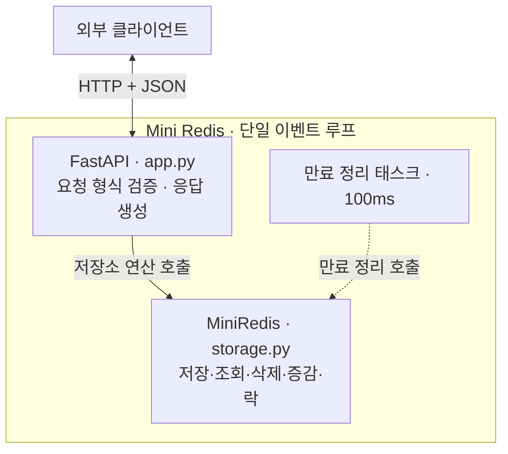
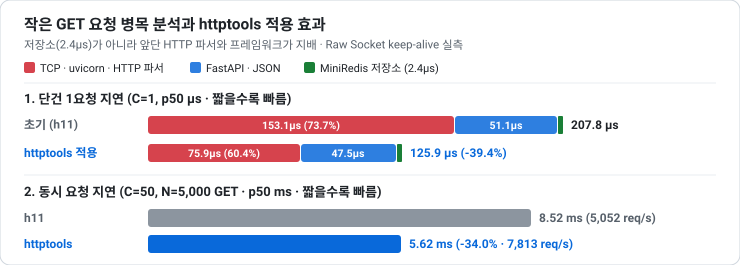

# Mini Redis


해시 테이블(`dict`) 기반 인메모리 Key-Value 저장소와 단일 이벤트 루프 FastAPI HTTP 서버로, 저장·조회·삭제, 원자적 증감, TTL 만료, 키별 락을 구현하고 검증한 학습용 Mini Redis입니다.

[1. 프로젝트 소개](#1-프로젝트-소개) | [2. 아키텍처](#2-아키텍처) | [3. 시나리오별 설계](#3-시나리오별-설계) | [4. 날씨 데모](#4-날씨-데모) | [5. 성능 비교와 요청 구간 분석](#5-성능-비교와-요청-구간-분석) | [6. 한계](#6-한계) | [빠른 시작](#빠른-시작) | [핵심 API 요약](#핵심-api-요약) | [테스트·검증 참고](#테스트검증-참고)

---

## 1. 프로젝트 소개

Mini Redis는 메모리에 데이터를 저장하고 키로 접근하는 인메모리 데이터 저장소입니다. 카운터·재고처럼 공유 데이터를 빠르게 읽고 갱신하거나, API 응답을 일정 시간 보관했다가 만료시키는 캐시 상황에서 활용할 수 있습니다.

제공하는 전체 연산은 [핵심 API 요약](#핵심-api-요약)에서 확인할 수 있습니다.

---

## 2. 아키텍처



실선은 요청 처리, 점선은 100ms 주기 만료 정리를 나타냅니다. 요청이 들어오면 `FastAPI`가 형식을 확인해 `MiniRedis`에 전달하고, `MiniRedis`가 데이터를 검증한 뒤 상태를 변경합니다.

- **계층 분리 (`FastAPI` ↔ `MiniRedis`)**: 전용 프로토콜 대신 HTTP + JSON API를 선택했고, HTTP 요청 확인·응답 생성(`app.py`)과 데이터 검증·상태 변경(`storage.py`)을 분리해 저장소 로직과 서버 로직 결합도를 낮췄습니다.

- **해시 테이블 (`dict`) 선택 이유**: 조인이나 범위 검색 대신 카운터 ID나 날씨 좌표처럼 이미 알고 있는 키로 빠르게 접근하는 데 집중해 Python 내장 `dict`를 사용했습니다. C로 구현되어 평균 O(1)로 빠르고, 해시 충돌·리사이즈 구현 대신 동시 갱신·TTL·락 구조에 집중할 수 있습니다.

- **FastAPI (ASGI) 전환 이유**: 초기 Flask(WSGI)에서는 주기적 만료 정리 타이머를 돌리려면 별도 스레드가 필요해 저장소 접근이 충돌할 수 있었습니다. `lifespan`으로 100ms 정리 태스크를 앱 생명주기에 묶어 실행할 수 있는 FastAPI로 전환해 동기화 부담을 없앴고, 처리량도 Flask 대비 약 1.6배 개선되었습니다([FastAPI 전환 설계](resc/fastapi-migration-design.md)).

- **단일 이벤트 루프 공유 이유**: 네트워크 요청·응답을 기다리는 동안에는 다른 요청을 번갈아 처리하면서도, 저장소에서 데이터를 읽고 바꾸는 작업 자체는 끝날 때까지 끊기지 않습니다. 덕분에 멀티스레드 서버처럼 저장소 내부에 별도 뮤텍스 락을 걸지 않고도 요청 처리와 만료 정리가 안전하게 공존합니다.

<details>
<summary>추가 결정</summary>

- **단일 키 접근 범위**: 대상을 키로 바로 지정할 수 있어 범용 SQL 질의(조인·범위 검색)와 재시작 후 보존을 제외하고 단일 키 연산에 집중했습니다.
- **Python 검증 생태계**: `pytest`, `Hypothesis`(Property/State-machine), `mutmut`(Mutation Testing) 등 도구로 핵심 로직과 테스트 신뢰성을 검증했습니다.

</details>

---

## 3. 시나리오별 설계

- **동시 갱신 — 읽기와 반영을 한 연산으로:** 클라이언트가 조회한 뒤 다시 저장하면 그 사이 다른 갱신이 끼어들 수 있기 때문에, 읽기·계산·조건 검사·반영을 저장소의 한 연산(`INCR`/`DECR`)으로 묶었습니다.

- **만료 — 즉시 확인과 주기 정리 병행:** 요청이 들어온 키는 그 시점에 만료 여부를 즉시 확인하고, 다시 조회되지 않는 키는 주기적으로 표본을 검사해 정리합니다.

- **갱신 경합 — 별도 락과 소유 토큰:** 여러 요청이 같은 키의 작업을 조정할 수 있도록 락 상태를 일반 데이터와 별도로 보관하며, 소유 토큰이 일치할 때만 락을 해제합니다.

<details>
<summary>만료 정리 상세</summary>

정리 태스크는 100ms마다 실행하며 1ms 예산을 기준으로 표본 검사를 반복합니다. 예산은 한 차례 검사 후 확인하므로 실제 시간은 1ms를 넘을 수 있으며, 만료된 항목을 반환하지 않는 시점과 메모리에서 제거되는 시점은 다를 수 있습니다. 실패하면 지수 backoff로 재시도하고, 5회 연속 실패 시 정리 태스크만 중단합니다.

만료 정리는 표본당 최대 20개를 검사하고 만료 비율이 25% 이상이면 최대 50회까지 반복합니다. 표본 선택과 삭제에는 보조 배열·위치 인덱스(swap-pop)를 사용합니다. 만료는 저장한 절대 시각으로 판정하며, 테스트에서는 시계와 표본 선택기를 주입해 경계와 정리 동작을 확인합니다. 자세한 내용은 [TTL 계약](resc/scenario_01_storage/01-ttl-contract.md)을 참고합니다.

</details>

---

## 4. 날씨 데모

날씨 데모 서버는 위치별 Open-Meteo 응답을 Mini Redis에 저장하고 재사용합니다.

1. **첫 번째 조회**: 저장된 응답이 없어 Open-Meteo를 호출하고 결과를 Mini Redis에 저장합니다.
2. **두 번째 조회**: 같은 장소를 다시 조회하면 저장된 응답을 재사용하며, 터미널에서 원본 호출 횟수가 늘지 않음을 확인합니다.
3. **동시 요청 겹침**: 같은 장소의 요청이 동시에 겹치는 경우는 키별 락으로 갱신을 조정하며, 별도 테스트로 확인했습니다.

별도 탭에서 `http://127.0.0.1:8000/monitor`를 열면 GET·락 획득·원본 호출·저장·락 해제와 오류를 실제 발생 순서대로 큰 글씨로 확인할 수 있습니다. 연결 이후 이벤트만 표시하며 새로고침하면 목록이 비워지고, 끊긴 구간은 복구하지 않습니다.

실행 및 시연 준비 방법은 [날씨 데모 안내](demo/README.md), 동시 캐시 미스에서의 락 사용과 검증 범위는 [데모 락 사용 계약](resc/scenario_05_cache_lock/05-weather-demo-lock-usage.md), 모니터의 이벤트·화면 계약은 [실행 모니터 계약](resc/scenario_04_response_cache/04-weather-monitor-contract.md)을 참고합니다.

---

## 5. 성능 비교와 요청 구간 분석

### MySQL 8.4와 Mini Redis 성능 비교

같은 카운터를 증가시키는 작업을 대상별·동시성별 10,000건씩 5회 교차 측정했습니다. **본 측정 총 40회, 400,000건이 모두 성공했고 매 회차 최종 카운터도 10,000**이었습니다. 정합성을 유지한 상태에서 MySQL은 `65.5~82.8 req/s`, Mini Redis는 `1,895.5~4,053.6 req/s`를 기록했습니다(디스크 동기화와 메모리 반영이라는 내구성 차이 포함).


<details>
<summary>측정 조건 · 지연 시간 · 저장소별 구성 비교</summary>

| 동시성 | Mini Redis 처리량 (req/s) | MySQL 8.4 처리량 (req/s) | Mini Redis p50 (ms) | MySQL 8.4 p50 (ms) |
| ---: | ---: | ---: | ---: | ---: |
| 1 | 1,895.5 | 65.5 | 0.388 | 16.051 |
| 10 | 4,053.6 | 82.8 | 2.106 | 118.323 |
| 50 | 4,027.9 | 82.7 | 11.183 | 599.218 |
| 100 | 4,014.5 | 82.5 | 22.503 | 1,202.481 |

Mini Redis는 FastAPI HTTP·메모리 반영, MySQL은 JDBC·디스크 동기화 설정을 사용했습니다. 서버·부하 도구·MySQL은 같은 호스트에 있었습니다. 자세한 조건과 한계는 [재측정 기록](resc/scenario_03_performance/03-fastapi-mysql-remeasurement-20261118.md)을 참고합니다.

| 항목 | Mini Redis (현재 구현) | SQLite (로컬 파일 WAL) | MySQL 8.4 (InnoDB) |
| :--- | :--- | :--- | :--- |
| **저장 위치** | 프로세스 메모리(`dict`) | 로컬 디스크 파일(`.sqlite3` + WAL) | 디스크(`log_bin=1`, `sync_binlog=1`, `innodb_flush_log_at_trx_commit=1`) |
| **호출 경로** | FastAPI HTTP (`127.0.0.1:5000`) | 프로세스 내 C 라이브러리(`sqlite3`) 직접 호출 | JDBC/네트워크 드라이버 |
| **동시성 제어** | 단일 이벤트 루프 순차 처리 | 쓰기 잠금 + `busy_timeout` | 행 단위 락 + 트랜잭션 로그 |
| **재시작 후 보존** | 보장 안 함(메모리 소멸) | 디스크 보존 | 디스크 보존 및 복구 |

</details>

### 요청 구간 분석과 개선



요청 처리 과정을 구간별로 분해해 본 결과, **`MiniRedis` 저장소 자체(`2.4 µs`, 1.1%)보다 앞단 HTTP 파서(`h11`)와 `FastAPI` 라우팅이 전체 지연의 약 98%**를 차지했습니다. 이에 파서·이벤트 루프·프레임워크·JSON 처리 후보를 비교하고, 기존 코드와 API 계약을 바꾸지 않고 적용할 수 있는 **HTTP 파서(`httptools`) 교체**를 우선 적용해 작은 조회 단건 지연 중앙값을 약 **39.4%** 줄였습니다(`207.8 → 125.9 µs`, 단건 벤치마크 표 기준 `-41.2%`). 나머지 후보는 계약 호환성 검토를 위해 보류했습니다.

| 변경 위치 | 해결하는 병목 | 교체 대안 | 결정 | 핵심 이유 |
| :--- | :--- | :--- | :--- | :--- |
| **HTTP 파서** | `h11` 파싱 · 응답 조립 | `httptools` | **우선 적용** | 코드·계약 무수정으로 즉시 개선 (`C=1` -41%, `C=50` -34%) |
| **이벤트 루프** | 루프 폴링 · 스케줄링 | `uvloop` | **미적용** | 단건 `asyncio` 비용 미미(`~8 µs` 이내) + Windows 미지원 |
| **웹 프레임워크** | `solve_dependencies` 진입 비용 | `Starlette` ([#10](https://github.com/bennjung/jungle-mini-redis-week11/issues/10)) | **후속 검토** | 스택 합의(`AGENTS.md`) 변경 + 향후 타입·스키마 확장성 검토 |
| **JSON 처리** | 큰 JSON 직렬화 · 역직렬화 | `orjson` ([#12](https://github.com/bennjung/jungle-mini-redis-week11/issues/12)) | **후속 검토** | 64비트 초과 정수 거절 등 기존 크기·타입 계약 호환 검증 필요 |

<details>
<summary>상세 수치 표 (`h11` vs `httptools` 단건 `C=1` · 측정 조건)</summary>

| 작업 | `h11` p50 (p99) | `httptools` p50 (p99) | 변화 |
| --- | ---: | ---: | ---: |
| `GET small` | 206.0 µs (311.2) | **121.1 µs** (201.8) | **-41.2%** |
| `PUT small` | 222.0 µs (533.2) | **144.9 µs** (277.9) | **-34.8%** |
| `INCR cnt` | 226.8 µs (679.1) | **142.5 µs** (294.0) | **-37.2%** |
| `PUT large (~16KB)` | 515.3 µs (1146.0) | **429.8 µs** (906.4) | **-16.6%** *(초기 820.4 µs 대비 -47.6%)* |

- 큰 JSON `16KB` `PUT`에서는 HTTP 경로에서 불필요했던 Python 재귀 타입 검증 제거와 `httptools` 적용으로 단건 지연이 `820.4 → 429.8 µs`로 줄었으며, `NaN`·무한대·순환 참조는 직렬화 과정에서 계속 거절합니다.
- 위 측정은 Raw Socket keep-alive 기반 로컬 프로파일링 결과이며, `dev` 기본 서버의 `httptools` 적용 여부는 설치 환경에 따라 다릅니다.
- 자세한 구간별 측정과 후속 안건은 [분석 기록](resc/scenario_03_performance/03-request-breakdown-analysis.md) 및 [이슈 #9](https://github.com/bennjung/jungle-mini-redis-week11/issues/9)를 참고합니다.

</details>

<details>
<summary>추가 측정: Flask → FastAPI 전환 후 속도 비교</summary>

### Flask → FastAPI 전환 후 속도 비교 ([집계 JSON](resc/scenario_03_performance/03-stack-comparison-results.json))

`lifespan` 기반 active TTL 정리를 구현하기 위해 Flask에서 FastAPI로 전환한 뒤, 동일 조건(N=10,000, 5회 중앙값, 총 140회·1,400,000건 실패 0건)에서 스택 차이와 TTL 비용을 측정했습니다.


- **TTL·active 정리 영향**: 같은 FastAPI 안에서 캐시 수명주기 시나리오의 TTL 유무 간 처리량 비율은 **0.94~0.99배**, 만료 키 10,000개가 쌓인 상태의 핫 키 조회 비율은 **0.96~1.01배**로 성능 저하가 거의 없었습니다.

<details>
<summary>JMeter 스택 비교 상세 수치 표 펼치기</summary>

| 동시성 | Flask (req/s) | FastAPI (req/s) | FastAPI / Flask | FastAPI p50 / p95 / p99 (ms) |
| ---: | ---: | ---: | ---: | :--- |
| 1 | 1,395.45 | 1,620.23 | 1.16배 | 0.430 / 0.984 / 1.558 |
| 10 | 2,335.45 | 3,813.06 | 1.63배 | 2.226 / 4.121 / 5.767 |
| 50 | 2,244.91 | 3,786.36 | 1.69배 | 12.045 / 18.886 / 23.947 |
| 100 | 2,253.51 | 3,715.39 | 1.65배 | 24.491 / 38.865 / 49.069 |

</details>

</details>

---

## 6. 한계

- **프로세스 메모리 보관**: 재시작 시 모든 데이터와 TTL이 사라집니다. 디스크 영속성과 재시작 복구는 후속 검토 항목입니다([이슈 #13](https://github.com/bennjung/jungle-mini-redis-week11/issues/13)).
- **단일 워커 개발 서버**: 다중 프로세스·스레드 안전성, 유저 레벨 대기열(FIFO), 연결 종료 시 이미 수신된 연산의 자동 취소는 보장하지 않습니다.
- **락의 늦은 쓰기 차단 미지원**: `RELEASE`는 소유 토큰을 검사하지만 `PUT /kv`는 락 토큰을 검사하지 않습니다. 따라서 락 TTL이 지난 뒤 늦게 도착한 쓰기가 새 `value`를 덮어쓸 수 있습니다([05 락 계약](resc/scenario_05_cache_lock/05-lock-contract.md)).

---

## 빠른 시작

### 설치 및 서버 실행

```sh
python3 -m venv .venv
.venv/bin/python -m pip install -r requirements-dev.txt
.venv/bin/python app.py
# Uvicorn running on http://127.0.0.1:5000
```

### Python 저장소 직접 사용 & HTTP 예시

```python
from storage import MiniRedis

redis = MiniRedis()
redis.set("concert:vip:seats", 500, ttl=60_000) # {'ok': True}
redis.get("concert:vip:seats")                 # {'found': True, 'value': 500}
redis.decr("concert:vip:seats", 1, minimum=0)  # {'ok': True, 'value': 499}
redis.ttl("concert:vip:seats")                 # {'found': True, 'ttl': ...}
```

```sh
curl -X PUT http://127.0.0.1:5000/kv -H 'Content-Type: application/json' \
  -d '{"key":"concert:vip:seats","value":500,"ttl":60000}'
curl 'http://127.0.0.1:5000/kv?key=concert%3Avip%3Aseats'
curl -X POST http://127.0.0.1:5000/kv/decr -H 'Content-Type: application/json' \
  -d '{"key":"concert:vip:seats","amount":1,"minimum":0}'
```

---

## 핵심 API 요약

전체 계약·예시·오류 우선순위는 [REST API 명세](rest-api.md)에서 확인할 수 있습니다.

| 기능 | 메서드 · 경로 | 입력 | 정상 응답 (`200`) |
| :--- | :--- | :--- | :--- |
| 저장·덮어쓰기(+TTL) | `PUT /kv` | JSON `{"key": str, "value": any_json, "ttl"?: int\|null}` | `{"ok": true}` |
| 조회 | `GET /kv?key=...` | 쿼리 `key` | 있음 `{"found": true, "value": ...}` / 없음 `{"found": false}` |
| 삭제 | `DELETE /kv?key=...` | 쿼리 `key` | 있음 `{"found": true, "value": ...}` / 없음 `{"found": false}` |
| 원자적 증가 | `POST /kv/incr` | JSON `{"key", "amount", "maximum"?}` | `{"ok": true, "value": <new>}` |
| 원자적 감소 | `POST /kv/decr` | JSON `{"key", "amount", "minimum"?}` | `{"ok": true, "value": <new>}` |
| TTL 설정·즉시 삭제 | `POST /kv/expire` | JSON `{"key": str, "ttl": int}` | `ttl>0`: `{"found":true,"ttl":ttl}` / `ttl<=0`: `{"found":true,"ttl":0}` / 없음: `{"found":false}` |
| 남은 TTL 조회 | `GET /kv/ttl?key=...` | 쿼리 `key` | 있음 `{"found":true,"ttl":ms}` / TTL 없음 `{"found":true,"ttl":-1}` / 키 없음 `{"found":false}` |
| TTL 제거 | `POST /kv/persist` | JSON `{"key": str}` | 제거 `{"found":true,"persisted":true}` / TTL 없음 `{"found":true,"persisted":false}` / 키 없음 `{"found":false}` |
| 키별 락 획득·연장 | `POST /kv/lock/acquire` | JSON `{"key": str, "token": str, "ttl": int}` | `{"acquired": true}` *(점유 중: `409 LOCK_BUSY`, `retry_after_ms`)* |
| 키별 락 해제 | `POST /kv/lock/release` | JSON `{"key": str, "token": str}` | `{"released": true \| false}` |

- **입력 제한**: `key`·`token` UTF-8 `1~256`바이트(`""`·`null` 불가), `value` JSON 직렬화 기준 `0~65,536`바이트, `ttl` 정수 밀리초.
- **오류 코드**: `INVALID_INPUT`(400), `TYPE_MISMATCH`(400), `NEGATIVE_AMOUNT`(400), `NOT_FOUND`(404), `CONDITION_NOT_MET`(409), `LOCK_BUSY`(409), `OUT_OF_RANGE`(422), `INTERNAL_SERVER_ERROR`(500).

---

## 테스트·검증 참고

### 기능 검증 및 테스트 신뢰성

저장·조회·삭제, 조건부 증감, TTL, 락 기능을 검증하며, 단순 통과 개수가 아니라 **테스트 자체의 결함 탐지력**도 함께 확인했습니다.

- **변이 테스트 (Mutation Testing)** ([mutation-testing.md](resc/mutation-testing.md)): 코드(`storage.py`)에 일부러 결함을 심었을 때 테스트가 제대로 실패하는지 확인해 형식적인 통과를 걸러냈습니다(살아남은 변이 지점은 [test_mutation_gaps.py](tests/scenario_01_storage/test_mutation_gaps.py)로 보강).
- **무작위 상태 탐색 (Hypothesis · Fuzz)** ([property-state-testing.md](resc/property-state-testing.md), [stress-test-plan.md](resc/stress-test-plan.md)): 무작위 입력과 연산 순서를 만들어 실행하고 매 단계 참조 모델과 비교해 연속 상태 전이 오류까지 검증했습니다.

### 테스트 실행

```sh
.venv/bin/python -m pytest tests/ -q
```

- 건너뛴 테스트는 `COUNTER_TEST_REPEAT`·`COUNTER_TEST_TIMEOUT`(실제 TCP 동시성 반복), `M3_RUN_JMETER=1`·`M3_RUN_JDBC=1`(외부 JMeter/MySQL 검증), `STRESS=1`(저장소 fuzz)을 지정했을 때만 실행됩니다.

### 구현 현황 및 로드맵

- [x] 해시 테이블(`dict`) 기반 Key-Value 저장·조회·삭제 및 입력 제한 검증 ([01 저장소 시나리오](resc/scenario_01_storage/01-storage-scenario.md))
- [x] JSON 전 자료형 저장 및 원자적 증감 `INCR`/`DECR` ([02 카운터 시나리오](resc/scenario_02_concurrent_counter/02-concurrent-counter-integrated-review.md))
- [x] FastAPI 단일 이벤트 루프 전환 ([FastAPI 전환 설계](resc/fastapi-migration-design.md))
- [x] TTL 만료 처리 및 날씨 응답 캐시 기능 테스트 ([01 TTL 계약](resc/scenario_01_storage/01-ttl-contract.md), [04 응답 캐시 시나리오](resc/scenario_04_response_cache/04-response-cache-scenario.md))
- [x] 캐시 갱신 중복 방지용 키별 원자적 락 (`ACQUIRE` / `RELEASE`, [05 락 계약](resc/scenario_05_cache_lock/05-lock-contract.md), [이슈 #14](https://github.com/bennjung/jungle-mini-redis-week11/issues/14))
- [x] FastAPI·Flask·TTL 스택 비교 ([03-stack-comparison-results.json](resc/scenario_03_performance/03-stack-comparison-results.json))
- [x] Mutation Testing([mutation-testing.md](resc/mutation-testing.md)) 및 Property/State-machine 탐색([property-state-testing.md](resc/property-state-testing.md))
- [ ] 디스크 영속성 및 재시작 복구 (미완성 — [이슈 #13](https://github.com/bennjung/jungle-mini-redis-week11/issues/13))
### 관련 문서

- [과제 요구사항](resc/phase.md) · [REST API 명세](rest-api.md) · [성능 실행 기록](resc/scenario_03_performance/03-performance-test-worklog.md) · [티켓 예매 시나리오 분석](docs/ticket-booking-scenario-analysis.md)
