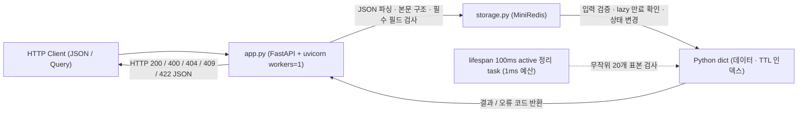
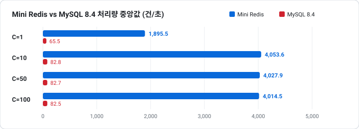
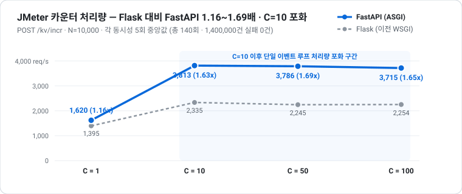

# Mini Redis


해시 테이블(`dict`) 기반 인메모리 Key-Value 저장소와 단일 이벤트 루프 FastAPI HTTP 서버로, 고빈도 읽기-수정-쓰기(RMW) 경합 정합성·TTL 만료를 구현하고 검증한 학습용 Mini Redis입니다.

> 실제 Redis 서버나 Redis 통신 규약을 구현한 것은 아닙니다. 데이터는 프로세스 메모리에만 보관하므로 서버를 재시작하면 사라집니다.

[1. 문제 정의 & 스택 선택](#1-문제-정의--스택-선택) | [2. 아키텍처 & 핵심 설계](#2-아키텍처--핵심-설계) | [3. 연산별 해결 & 속도 데모](#3-연산별-문제-해결--속도-데모) | [4. 성능 벤치마크 & 병목 해석](#4-성능-벤치마크--병목-해석) | [5. AI 테스트 신뢰성 검증](#5-ai-테스트-신뢰성-검증) | [빠른 시작](#빠른-시작) | [핵심 API 요약](#핵심-api-요약)

---

## 1. 문제 정의 & 스택 선택

선착순 재고 차감, 실시간 카운터, API 응답 캐시처럼 **동일 키에 고빈도 조회·갱신이 몰리는 상황**에서는 디스크 RDBMS 지연과 비원자적 읽기-덮어쓰기(`GET → PUT`)로 인한 **갱신 유실(Lost Update)**·초과 판매가 발생합니다.

### 왜 Python + FastAPI(ASGI)인가?

- **Python을 쓴 이유**:
  - **빠른 구현과 설명력**: TTL 인덱스·만료 예산·원자적 증감 같은 핵심 로직을 군더더기 없이 직관적으로 작성하고 설명할 수 있습니다.
  - **핵심 저장소(`dict`)는 C 레벨 속도**: 내장 `dict`가 C로 구현된 해시 테이블이라 저장소 연산 자체는 매우 빠릅니다.
  - **탄탄한 검증 도구**: `pytest`, `Hypothesis`(Property/State-machine), `mutmut`(Mutation Testing)을 바로 붙여 정합성과 테스트 신뢰성을 빠르게 검증할 수 있습니다.
- **FastAPI + `uvicorn (workers=1)`을 쓴 이유**:
  - **단일 이벤트 루프 모델**: Redis처럼 하나의 이벤트 루프에서 요청을 순차 처리해 별도 락 없이 단일 키 원자성을 지키기 좋습니다.
  - **`lifespan` 백그라운드 TTL 정리**: ASGI 앱 수명주기(`lifespan`) 안에서 요청 처리 루프와 **100ms 주기 active TTL 정리 태스크**를 함께 소유하고 안전하게 시작·종료할 수 있습니다([FastAPI 전환 설계](resc/fastapi-migration-design.md)).

### 핵심 기능

- **인메모리 해시 테이블 저장소**: 디스크 I/O와 SQL 질의 비용을 없애고 키 기반 조회·갱신을 평균 O(1)로 끝내기 위해, [storage.py](storage.py)의 `MiniRedis`가 인스턴스별 Python `dict`를 사용합니다.
- **락 없는 단일 이벤트 루프 처리**: 멀티스레드 환경의 잠금 경합·교착 위험 없이 단일 키 정합성을 지키기 위해, 별도 뮤텍스 대신 단일 이벤트 루프에서 요청을 차례대로 처리합니다.
- **상·하한 조건부 원자 증감**: 클라이언트가 `GET`으로 확인하고 `PUT`으로 덮어쓰는 사이 다른 요청이 끼어드는 문제(초과 판매·총량 초과)를 막기 위해, `minimum`·`maximum` 검사와 증감을 한 연산으로 묶습니다.
- **요청 시 + 주기적 TTL 만료 정리**: 만료된 값 반환을 막으면서도 매번 전체 키를 훑는 비용을 피하기 위해, 요청 시 정리(lazy)와 주기별 표본 정리(active)를 함께 사용합니다.
- **JSON 자료형 그대로 보관**: 호출자가 숫자·객체·배열을 매번 문자열로 바꾸고 다시 해석하다 타입이 틀어지는 일을 막기 위해, 모든 JSON 자료형을 원래 타입 그대로 저장합니다(항목당 `value` 최대 65,536바이트).

---

## 2. 아키텍처 & 핵심 설계



### 핵심 설계 결정

1. **입력 검증 책임 분리**: `app.py`는 JSON 해석·본문 구조·필수 필드만 검사하고, `storage.py`는 `key`·`value`·`ttl` 타입, UTF-8 바이트 크기, 증감 조건(`minimum`/`maximum`)을 상태 변경 전에 검사합니다.
2. **TTL 이중 만료 + 기본 `dict` 우회용 O(1) 표본 인덱스**: **기본 `dict`를 그대로 쓰면서 O(1) 무작위 추출과 O(1) 삭제를 구현하기 위해**, 만료 시각 `dict` 외에 보조 배열과 위치 인덱스(swap-pop)를 두는 우회 구조를 택했습니다. 정리는 100ms 주기로, 정리 작업 시간 제한을 둬(**1ms · 표본 20개 · 만료율 25% 이상 시 최대 50회 반복**) 요청 지연을 막습니다.
3. **active 정리 장애 격리**: 백그라운드 100ms 정리 루프(`_timer_loop`)에서 예외가 나도 HTTP 서버 전체가 죽지 않도록 지수 backoff(상한 5초)로 재시도하며, 5회 연속 실패 시 active 정리만 멈춘 채 요청 처리와 lazy 만료는 계속 동작합니다.
4. **절대 만료 시각 저장 + 시계·표본 주입**: 남은 시간을 매 틱 갱신하지 않고 `now + ttl` 절대 시각을 기록해 O(1) 비교로 만료를 판정(연산당 단일 `now` 스냅샷 사용)하며, `clock`·`sampler`·`monotonic`·`sleep` 주입으로 실제 대기 없이 `1ms` 경계와 active 정리를 결정론적으로 테스트합니다.


### 저장소별 비교

성능·내구성 트레이드오프를 비교하기 위해 디스크 기반 RDBMS(SQLite, MySQL 8.4)와 구조를 대조했습니다.

| 항목 | Mini Redis (현재 구현) | SQLite (로컬 파일 WAL) | MySQL 8.4 (InnoDB) |
| :--- | :--- | :--- | :--- |
| **저장 위치** | 프로세스 메모리(`dict`) | 로컬 디스크 파일(`.sqlite3` + WAL) | 디스크(`log_bin=1`, `sync_binlog=1`, `innodb_flush_log_at_trx_commit=1`) |
| **호출 경로** | FastAPI HTTP (`127.0.0.1:5000`) | 프로세스 내 C 라이브러리(`sqlite3`) 직접 호출 | JDBC/네트워크 드라이버 |
| **동시성 제어** | 단일 이벤트 루프 순차 처리 | 쓰기 잠금 + `busy_timeout` | 행 단위 락 + 트랜잭션 로그 |
| **재시작 후 보존** | 보장 안 함(메모리 소멸) | 디스크 보존 | 디스크 보존 및 복구 |

---

## 3. 연산별 문제 해결 & 속도 데모

### 연산별 도입 이유 (시간 관점 · 원자성)

| 연산 (HTTP / 메서드) | 해결하는 문제 (시간 관점 · 원자성) |
| :--- | :--- |
| **`PUT /kv`** (`set`) | 디스크 I/O·트랜잭션 대기 없이 **O(1) 메모리 기록 시간**으로 상태·캐시를 즉시 저장·갱신 |
| **`GET /kv`** (`get`) | 반복 읽기마다 DB·원본 API 왕복 시간을 쓰지 않고 **O(1) 메모리 조회 시간**으로 즉시 재사용 (`null` 저장과 키 없음 구분) |
| **`DELETE /kv`** (`delete`) | 만료 시각까지 기다리지 않고 **원본 변경 즉시 유효 시간을 종료**(Stale Data 노출 구간 제거) |
| **`POST /kv/incr`** (`incr`, `maximum`) | `GET → PUT` 2회 왕복과 사이의 경합 시간 틈(Race Window)을 없애고 **원자적 증가·상한 검사** 보장 |
| **`POST /kv/decr`** (`decr`, `minimum`) | `GET → PUT` 사이 경합 틈을 제거하고 **원자적 차감·하한(`minimum`) 검사**로 초과 판매(음수 재고) 방지 |
| **`TTL` 연산군** (`PUT ttl`, `expire`, `ttl`, `persist`) | 밀리초 단위 **유효 시간 창**을 부여·연장·조회·해제해 수동 `DELETE` 없이 자동 만료·메모리 회수 |
| **`LOCK` 연산군** (`lock/acquire`, `lock/release`) | 캐시 미스 시 **키별 갱신 락(TTL + `retry_after_ms`)**으로 여러 앱 서버의 외부 API 중복 호출 방지 |

### 라이브 속도 데모 (`demo_speed.py`)

현재 `app.py` + `storage.py` 서버를 기동해 **25,000건 HTTP keep-alive 처리(`C=50`) + TTL 만료 + 수동 `DELETE`**를 약 5초 만에 실행합니다.

```sh
.venv/bin/python demo_speed.py
```

- **MiniRedis Python 직접 조회 10,000건**: `0.0018초` (**5,526,516.8 req/s**)

| 작업 (FastAPI HTTP, C=50) | 요청 수 | 소요(초) | 처리량(req/s) | p50(ms) | p95(ms) | p99(ms) |
| --- | ---: | ---: | ---: | ---: | ---: | ---: |
| `PUT /kv` (저장 + TTL 60s) | 10,000 | 1.695 | **5,900.2** | 8.06 | 10.79 | 12.17 |
| `GET /kv` (조회 히트) | 10,000 | 1.580 | **6,327.9** | 7.48 | 10.46 | 12.12 |
| `POST /kv/incr` (원자적 증가) | 5,000 | 0.854 | **5,857.1** | 7.97 | 10.94 | 12.68 |

- **동작 확인**: 카운터 최종값 `5,050`(워밍업 50 + 본 실행 5,000), `TTL 300ms` 직후 조회 `found: True` → `350ms` 후 `found: False`, 수동 `DELETE` 직후 `found: False` 확인.

---

## 4. 성능 벤치마크 & 병목 해석

### 1) SQL(MySQL 8.4)과 Mini Redis 성능 비교



- **외부 디스크 RDBMS (MySQL 8.4 vs Mini Redis HTTP)**: JMeter 동일 카운터 `1` 증가(`N=10,000`)에서 디스크 동기화 설정(`sync_binlog=1`, `innodb_flush_log_at_trx_commit=1`)을 쓴 MySQL 8.4(`66.7~82.6 req/s`)보다 Mini Redis HTTP(`1,593.6~2,582.5 req/s`, 전환 전 Flask 기준)가 **약 23.9~31.2배** 높았습니다([집계 JSON](resc/scenario_03_performance/03-performance-results.json)). *(현재 FastAPI 기준 MySQL 재측정은 미수행)*

<details>
<summary>MySQL 8.4 vs Mini Redis 상세 수치 표 펼치기</summary>

| 동시성 | Mini Redis 처리량 (req/s) | MySQL 8.4 처리량 (req/s) | Mini Redis p50 (ms) | MySQL 8.4 p50 (ms) |
| ---: | ---: | ---: | ---: | ---: |
| 1 | 1,593.6 | 66.7 | 0.47 | 15.90 |
| 10 | 2,582.5 | 82.6 | 3.41 | 118.81 |
| 50 | 2,544.8 | 82.5 | 18.29 | 601.12 |
| 100 | 2,482.9 | 82.2 | 37.72 | 1,208.90 |

</details>

### 2) 병목 구간 분석 및 개선 효과 (`perf/request-breakdown` 브랜치 실측)


- **구간별 차지 시간**: Raw Socket keep-alive 프로파일링 결과, 작은 `GET` 1요청(`p50 125.9 µs`) 중 **`MiniRedis` 저장소 자체는 `2.4 µs`(1.9%)**에 불과하고 나머지 **98.1%**가 `TCP + uvicorn + HTTP 파서(60.4%)`와 `FastAPI + JSON 직렬화(37.7%)` 구간이었습니다.
- **병목 개선 (`h11 → httptools`, 중복 재귀 검증 제거)**:
  - Pure-Python HTTP 파서 `h11`을 C 기반 `httptools`로 교체하자 동시 요청(`C=50`, `N=5,000`) 처리량이 `5,051.9 → 7,813.3 req/s`(**+54.7%**, `p50 8.52 → 5.62 ms`)로 개선됐습니다.
  - 16KB 큰 JSON `PUT`은 불필요한 재귀 검증 제거 + `httptools` 적용으로 단건 지연이 `820.4 → 429.8 µs`(**-47.6%**) 줄었습니다. *(위 `httptools`·재귀 제거 최적화는 `perf/request-breakdown` 브랜치 측정 결과이며, 현재 `dev` 기본 서버는 `h11` 기준입니다.)*

<details>
<summary>병목 구간 및 개선 전후 상세 수치 표 펼치기</summary>

#### `h11` vs `httptools` 단건 (`C=1`, Raw Socket keep-alive)

| 작업 | `h11` p50 (p99) | `httptools` p50 (p99) | 변화 |
| --- | ---: | ---: | ---: |
| `GET small` | 206.0 µs (311.2) | **121.1 µs** (201.8) | **-41.2%** |
| `PUT small` | 222.0 µs (533.2) | **144.9 µs** (277.9) | **-34.8%** |
| `INCR cnt` | 226.8 µs (679.1) | **142.5 µs** (294.0) | **-37.2%** |
| `PUT large (~16KB)` | 515.3 µs (1146.0) | **429.8 µs** (906.4) | **-16.6%** *(초기 820.4 µs 대비 -47.6%)* |

</details>

### 3) (선택) Flask → FastAPI 전환 후 속도 비교 ([집계 JSON](resc/scenario_03_performance/03-stack-comparison-results.json))

`lifespan` 기반 active TTL 정리를 구현하기 위해 Flask에서 FastAPI로 전환한 뒤, 동일 조건(N=10,000, 5회 중앙값, 총 140회·1,400,000건 실패 0건)에서 스택 차이와 TTL 비용을 측정했습니다.



- **TTL·active 정리 영향**: 같은 FastAPI 안에서 캐시 수명주기 시나리오의 TTL 유무 간 처리량 비율은 **0.94~0.99배**, 만료 키 10,000개가 쌓인 상태의 핫 키 조회 비율은 **0.96~1.01배**로 성능 저하가 거의 없었습니다.

<details>
<summary>JMeter 스택 비교 상세 수치 표 펼치기</summary>

| 동시성 | Flask (req/s) | FastAPI (req/s) | FastAPI / Flask | FastAPI p50 / p95 / p99 (ms) |
| ---: | ---: | ---: | ---: | :--- |
| 1 | 1,395.45 | 1,620.23 | 1.16배 | 0.430 / 0.984 / 1.558 |
| 10 | 2,335.45 | 3,813.06 | 1.63배 | 2.226 / 4.121 / 5.767 |
| 50 | 2,244.91 | 3,786.36 | 1.69배 | 12.045 / 18.886 / 23.947 |
| 100 | 2,253.51 | 3,715.39 | 1.65배 | 24.491 / 38.865 / 49.069 |

</details>

---

## 5. AI 테스트 신뢰성 검증

AI가 작성한 테스트는 **"통과" 자체는 쉽게 만들지만, 검증 시점이 느슨하거나 경계값이 빠져도 조용히 통과하는 맹점**이 있습니다. 그래서 단순 통과 개수가 아니라 **테스트 자체의 결함 탐지력**을 두 가지 방법으로 검증했습니다.

- **변이 테스트 (Mutation Testing)** ([mutation-testing.md](resc/mutation-testing.md)): 코드(`storage.py`)에 일부러 결함을 심었을 때 테스트가 제대로 실패하는지 확인해 형식적인 통과를 걸러냈습니다(살아남은 변이 지점은 [test_mutation_gaps.py](tests/scenario_01_storage/test_mutation_gaps.py)로 보강).
- **무작위 상태 탐색 (Hypothesis · Fuzz)** ([property-state-testing.md](resc/property-state-testing.md), [stress-test-plan.md](resc/stress-test-plan.md)): 정해진 예시 몇 개만 확인하는 대신, 무작위 입력과 연산 순서를 만들어 실행하고 매 단계 참조 모델과 비교해 연속 상태 전이 오류까지 검증했습니다.

---

## 빠른 시작

### 설치 및 서버 실행

```sh
python3 -m venv .venv
.venv/bin/python -m pip install -r requirements-dev.txt
.venv/bin/python app.py
# Uvicorn running on http://127.0.0.1:5000
```

### Python 저장소 직접 사용 & HTTP 예시

```python
from storage import MiniRedis

redis = MiniRedis()
redis.set("concert:vip:seats", 500, ttl=60_000) # {'ok': True}
redis.get("concert:vip:seats")                 # {'found': True, 'value': 500}
redis.decr("concert:vip:seats", 1, minimum=0)  # {'ok': True, 'value': 499}
redis.ttl("concert:vip:seats")                 # {'found': True, 'ttl': ...}
```

```sh
curl -X PUT http://127.0.0.1:5000/kv -H 'Content-Type: application/json' \
  -d '{"key":"concert:vip:seats","value":500,"ttl":60000}'
curl 'http://127.0.0.1:5000/kv?key=concert%3Avip%3Aseats'
curl -X POST http://127.0.0.1:5000/kv/decr -H 'Content-Type: application/json' \
  -d '{"key":"concert:vip:seats","amount":1,"minimum":0}'
```

---

## 핵심 API 요약

전체 계약·예시·오류 우선순위는 [REST API 명세](rest-api.md)에서 확인할 수 있습니다.

| 기능 | 메서드 · 경로 | 입력 | 정상 응답 (`200`) |
| :--- | :--- | :--- | :--- |
| 저장·덮어쓰기(+TTL) | `PUT /kv` | JSON `{"key": str, "value": any_json, "ttl"?: int\|null}` | `{"ok": true}` |
| 조회 | `GET /kv?key=...` | 쿼리 `key` | 있음 `{"found": true, "value": ...}` / 없음 `{"found": false}` |
| 삭제 | `DELETE /kv?key=...` | 쿼리 `key` | 있음 `{"found": true, "value": ...}` / 없음 `{"found": false}` |
| 원자적 증가 | `POST /kv/incr` | JSON `{"key", "amount", "maximum"?}` | `{"ok": true, "value": <new>}` |
| 원자적 감소 | `POST /kv/decr` | JSON `{"key", "amount", "minimum"?}` | `{"ok": true, "value": <new>}` |
| TTL 설정·즉시 삭제 | `POST /kv/expire` | JSON `{"key": str, "ttl": int}` | `ttl>0`: `{"found":true,"ttl":ttl}` / `ttl<=0`: `{"found":true,"ttl":0}` / 없음: `{"found":false}` |
| 남은 TTL 조회 | `GET /kv/ttl?key=...` | 쿼리 `key` | 있음 `{"found":true,"ttl":ms}` / TTL 없음 `{"found":true,"ttl":-1}` / 키 없음 `{"found":false}` |
| TTL 제거 | `POST /kv/persist` | JSON `{"key": str}` | 제거 `{"found":true,"persisted":true}` / TTL 없음 `{"found":true,"persisted":false}` / 키 없음 `{"found":false}` |
| 키별 락 획득·연장 | `POST /kv/lock/acquire` | JSON `{"key": str, "token": str, "ttl": int}` | `{"acquired": true}` *(점유 중: `409 LOCK_BUSY`, `retry_after_ms`)* |
| 키별 락 해제 | `POST /kv/lock/release` | JSON `{"key": str, "token": str}` | `{"released": true \| false}` |

- **입력 제한**: `key`·`token` UTF-8 `1~256`바이트(`""`·`null` 불가), `value` JSON 직렬화 기준 `0~65,536`바이트, `ttl` 정수 밀리초.
- **오류 코드**: `INVALID_INPUT`(400), `TYPE_MISMATCH`(400), `NEGATIVE_AMOUNT`(400), `NOT_FOUND`(404), `CONDITION_NOT_MET`(409), `LOCK_BUSY`(409), `OUT_OF_RANGE`(422), `INTERNAL_SERVER_ERROR`(500).

---

## 검증 · 한계 · 구현 현황

### 테스트 실행

```sh
.venv/bin/python -m pytest tests/ -q
# 343 passed, 28 skipped
```

- 건너뛴 테스트는 `COUNTER_TEST_REPEAT`·`COUNTER_TEST_TIMEOUT`(실제 TCP 동시성 반복), `M3_RUN_JMETER=1`·`M3_RUN_JDBC=1`(외부 JMeter/MySQL 검증), `STRESS=1`(저장소 fuzz)을 지정했을 때만 실행됩니다.

### 한계

- **메모리 전용 (영속성 미완성)**: 현재는 재시작 시 모든 데이터와 TTL이 사라집니다. "없어져도 되는" 캐시로 쓰더라도 재시작 직후 Cold Start·Cache Stampede(원본 DB 부하 폭증) 방지, Warm-up 지연 단축, TTL 잔여 수명 유지를 위해 영속성이 필요하므로 후속 구현 대상으로 분리했습니다([이슈 #13](https://github.com/bennjung/jungle-mini-redis-week11/issues/13)).
- **단일 워커 개발 서버**: 다중 프로세스·스레드 안전성, 유저 레벨 대기열(FIFO), 연결 종료 시 이미 수신된 연산의 자동 취소는 보장하지 않습니다.
- **Fencing Token 미지원 (`ACQUIRE` / `RELEASE` 한계)**: `RELEASE`는 소유 토큰을 검사해 남의 락을 지우지 못하게 막지만, 일반 `PUT /kv`는 락 토큰을 검사하지 않습니다. 따라서 락을 잡은 서버가 락 TTL보다 오래 지연된 뒤 늦게 `PUT /kv`를 보내면 이미 갱신된 최신 캐시를 덮어쓸 수 있습니다([05 락 계약](resc/scenario_05_cache_lock/05-lock-contract.md)).

### 구현 현황 및 로드맵

- [x] 해시 테이블(`dict`) 기반 Key-Value 저장·조회·삭제 및 입력 제한 검증 ([01 저장소 시나리오](resc/scenario_01_storage/01-storage-scenario.md))
- [x] JSON 전 자료형 저장 및 원자적 증감 `INCR`/`DECR` ([02 카운터 시나리오](resc/scenario_02_concurrent_counter/02-concurrent-counter-integrated-review.md))
- [x] FastAPI 단일 이벤트 루프 전환 ([FastAPI 전환 설계](resc/fastapi-migration-design.md))
- [x] TTL 만료 처리 및 날씨 응답 캐시 기능 테스트 ([01 TTL 계약](resc/scenario_01_storage/01-ttl-contract.md), [04 응답 캐시 시나리오](resc/scenario_04_response_cache/04-response-cache-scenario.md))
- [x] 캐시 갱신 중복 방지용 키별 원자적 락 (`ACQUIRE` / `RELEASE`, [05 락 계약](resc/scenario_05_cache_lock/05-lock-contract.md), [이슈 #14](https://github.com/bennjung/jungle-mini-redis-week11/issues/14))
- [x] FastAPI·Flask·TTL 스택 비교 ([03-stack-comparison-results.json](resc/scenario_03_performance/03-stack-comparison-results.json)) 및 라이브 속도 데모 ([demo_speed.py](demo_speed.py))
- [x] Mutation Testing([mutation-testing.md](resc/mutation-testing.md)) 및 Property/State-machine 탐색([property-state-testing.md](resc/property-state-testing.md))
- [ ] 디스크 영속성 및 재시작 복구 (미완성 — [이슈 #13](https://github.com/bennjung/jungle-mini-redis-week11/issues/13))
- [ ] 현재 FastAPI 구현과 MySQL 8.4의 동일 조건 JMeter 재측정

### 관련 문서

- [과제 요구사항](resc/phase.md) · [REST API 명세](rest-api.md) · [성능 실행 기록](resc/scenario_03_performance/03-performance-test-worklog.md) · [티켓 예매 시나리오 분석](docs/ticket-booking-scenario-analysis.md)
