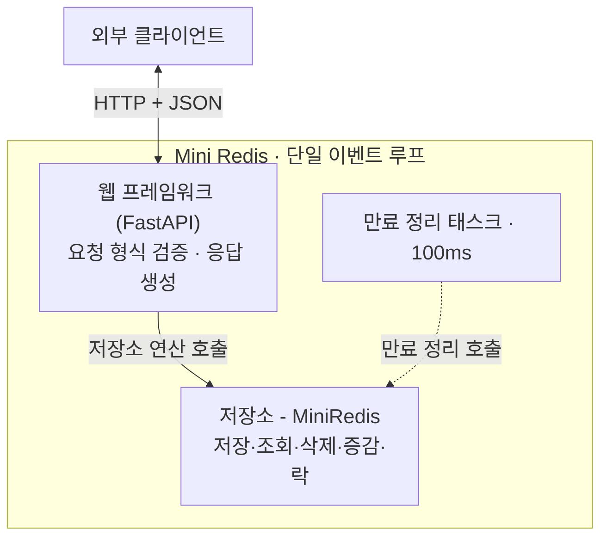

# Mini Redis


해시 테이블(`dict`) 기반 인메모리 Key-Value 저장소와 단일 이벤트 루프 FastAPI HTTP 서버로, 저장·조회·삭제, 원자적 증감, TTL 만료, 키별 락을 구현하고 검증한 학습용 Mini Redis입니다.

[1. 프로젝트 소개](#1-프로젝트-소개) | [2. 아키텍처](#2-아키텍처) | [3. 시나리오 기반 기능 설계](#3-시나리오-기반-기능-설계) | [4. 날씨 데모](#4-날씨-데모) | [5. 성능 비교와 요청 구간 분석](#5-성능-비교와-요청-구간-분석) | [6. 한계](#6-한계) | [빠른 시작](#빠른-시작) | [핵심 API 요약](#핵심-api-요약) | [테스트·검증 참고](#테스트검증-참고)

---

## 1. 프로젝트 소개

- **문제 배경**: 카운터처럼 자주 읽고 갱신하는 데이터를 매번 DB로 처리하면 지연과 부하가 큼.
- **결과**: redis와 같이 데이터를 메모리에 **key-value** 형태로 보관해 빠르게 읽고 갱신하는 In-Memory DB 구현.

---

## 2. 아키텍처 및 결정



실선은 요청 처리, 점선은 100ms 주기 만료 정리를 나타냅니다.

- **Key-Value 모델 (해시 테이블)**
  - 복잡한 검색이 아닌, 이미 사용자가 알고 있는 키로 바로 찾는 형태 → 복잡한 로직 없이 해시 테이블로 상수 시간 내 접근 가능

- **Python · 내장 딕셔너리**
  - 빠른 구현·검증을 위해 **Python** 선택
  - C 구현 **내장 딕셔너리**로 해시 테이블을 구성해 저수준 구현 대신 상위 로직에 집중

- **REST API 통신**
  - 전용 프로토콜 대신 빠르게 구현할 수 있는 **REST API** 선택

- **uvicorn 단일 이벤트 루프 구조 + FastAPI** 
  - `uvicorn` 단일 스레드 이벤트 루프로 응답 대기 중 다른 요청을 처리하고 저장소 연산은 순차 실행 → redis처럼 **내부 락 없이 원자적 저장소 연산**
  - 별도 스레드 없이 **주기적인 무효화 정리** 로직을 함께 실행 가능

<details>
<summary>추가 결정</summary>

- **데이터 조작과 영속성 보장 제외**: 대상을 키로 바로 지정할 수 있어 범용 SQL 질의(조인·범위 검색)와 재시작 후 보존을 제외하고 단일 키 연산에 집중

- **Python 검증 생태계**: `pytest`, `Hypothesis`(Property/State-machine), `mutmut`(Mutation Testing) 등으로 핵심 로직과 테스트 신뢰성 검증

- **FastAPI (ASGI) 전환** ([FastAPI 전환 설계](resc/fastapi-migration-design.md))
  - 초기 Flask(WSGI)의 타이머 스레드·저장소 충돌 우려를 없애고자 `lifespan` 단일 루프 구조로 전환(처리량 약 1.6배 개선)
  - 저장소 로직(`storage.py`)과 웹 프레임워크 로직(`app.py`)이 분리되어 있어 빠른 전환 가능

</details>

---

## 3. 시나리오 기반 기능 설계

- **기준 시나리오**: **외부 날씨 API 응답 캐싱** 시나리오를 기준으로 두 가지 기능을 도출.

- **시간 경과에 따른 무효화 → TTL · 즉시/주기 정리**
  - **문제**: 날씨는 시간이 지나면 바뀌며, 무효화 및 새로고침이 필요. 이때 여러 백엔드 서버가 하나의 캐시를 공유할 때는 서버마다 무효화 판단이 어긋날 수 있음
  - **해결**: `MiniRedis`가 키별 시간 기준 무효 판정(TTL)을 맡고, 무효화된 키에 대해 **키 요청 시 제거**와 **주기적 정리**를 함께 수행해 무효 키 제거

- **만료 순간 동시 요청(캐시 스탬피드) → 키별 락 (`ACQUIRE`/`RELEASE`)**
  - **문제**: 캐시 만료 순간 여러 서버 요청이 동시에 몰려 외부 API 중복 호출
  - **해결**: 일반 데이터와 분리된 **키별 락**으로 **한 요청만 캐시 갱신** 권한 부여

<details>
<summary>만료 정리 상세</summary>

- **주기 · 예산 · 장애 대응**
  - **실행 주기**: 100ms마다 실행하며 1ms 예산 기준으로 표본 검사 반복 *(예산은 1회 검사 후 확인하므로 실제 시간은 1ms를 넘을 수 있음)*
  - **시점 차이**: 만료 항목을 반환하지 않는 시점과 메모리에서 제거되는 시점은 다를 수 있음
  - **오류 복구**: 실패 시 지수 backoff 재시도, 5회 연속 실패 시 정리 태스크만 중단
- **표본 검사 · 인덱스 · 테스트** ([TTL 계약](resc/scenario_01_storage/01-ttl-contract.md))
  - **표본 규칙**: 표본당 최대 20개 검사, 만료 비율 25% 이상이면 최대 50회 반복
  - **자료구조 · 판정**: 보조 배열·위치 인덱스(swap-pop) 사용, 저장한 절대 시각 기준 판정
  - **테스트**: 시계와 표본 선택기를 주입해 경계와 정리 동작 검증

</details>

---

## 4. 날씨 데모

날씨 데모 서버는 위치별 Open-Meteo 응답을 Mini Redis에 저장하고 재사용합니다.

1. **첫 번째 조회**: 저장된 응답이 없어 Open-Meteo를 호출하고 결과를 Mini Redis에 저장합니다.
2. **두 번째 조회**: 같은 장소를 다시 조회하면 저장된 응답을 재사용하며, 터미널에서 원본 호출 횟수가 늘지 않음을 확인합니다.
3. **동시 요청 겹침**: 같은 장소의 요청이 동시에 겹치는 경우는 키별 락으로 갱신을 조정하며, 별도 테스트로 확인했습니다.

별도 탭에서 `http://127.0.0.1:8000/monitor`를 열면 GET·락 획득·원본 호출·저장·락 해제와 오류를 실제 발생 순서대로 큰 글씨로 확인할 수 있습니다. 연결 이후 이벤트만 표시하며 새로고침하면 목록이 비워지고, 끊긴 구간은 복구하지 않습니다.

실행 및 시연 준비 방법은 [날씨 데모 안내](demo/README.md), 동시 캐시 미스에서의 락 사용과 검증 범위는 [데모 락 사용 계약](resc/scenario_05_cache_lock/05-weather-demo-lock-usage.md), 모니터의 이벤트·화면 계약은 [실행 모니터 계약](resc/scenario_04_response_cache/04-weather-monitor-contract.md)을 참고합니다.

---

## 5. 성능 비교와 요청 구간 분석

### MySQL 8.4와 Mini Redis 성능 비교

- **조건**: 동일 카운터 증가, 동시성별 10,000건 × 5회 교차 측정
- **정합성**: 본 측정 **총 40회, 400,000건 모두 성공** · 매 회차 최종 카운터 **10,000**
- **처리량**: MySQL `65.5~82.8 req/s` vs Mini Redis `1,895.5~4,053.6 req/s` *(디스크 동기화 vs 메모리 반영 차이 포함)*


<details>
<summary>측정 조건 · 지연 시간 · 저장소별 구성 비교</summary>

| 동시성 | Mini Redis 처리량 (req/s) | MySQL 8.4 처리량 (req/s) | Mini Redis p50 (ms) | MySQL 8.4 p50 (ms) |
| ---: | ---: | ---: | ---: | ---: |
| 1 | 1,895.5 | 65.5 | 0.388 | 16.051 |
| 10 | 4,053.6 | 82.8 | 2.106 | 118.323 |
| 50 | 4,027.9 | 82.7 | 11.183 | 599.218 |
| 100 | 4,014.5 | 82.5 | 22.503 | 1,202.481 |

Mini Redis는 FastAPI HTTP·메모리 반영, MySQL은 JDBC·디스크 동기화 설정을 사용했습니다. 서버·부하 도구·MySQL은 같은 호스트에 있었습니다. 자세한 조건과 한계는 [재측정 기록](resc/scenario_03_performance/03-fastapi-mysql-remeasurement-20261118.md)을 참고합니다.

| 항목 | Mini Redis (현재 구현) | SQLite (로컬 파일 WAL) | MySQL 8.4 (InnoDB) |
| :--- | :--- | :--- | :--- |
| **저장 위치** | 프로세스 메모리(`dict`) | 로컬 디스크 파일(`.sqlite3` + WAL) | 디스크(`log_bin=1`, `sync_binlog=1`, `innodb_flush_log_at_trx_commit=1`) |
| **호출 경로** | FastAPI HTTP (`127.0.0.1:5000`) | 프로세스 내 C 라이브러리(`sqlite3`) 직접 호출 | JDBC/네트워크 드라이버 |
| **동시성 제어** | 단일 이벤트 루프 순차 처리 | 쓰기 잠금 + `busy_timeout` | 행 단위 락 + 트랜잭션 로그 |
| **재시작 후 보존** | 보장 안 함(메모리 소멸) | 디스크 보존 | 디스크 보존 및 복구 |

</details>

### 요청 구간 분석과 개선


- **병목 원인**: 구간 분해 결과 저장소 로직(`MiniRedis`) 자체(`2.4 µs`, **1.1%**)보다 앞단 HTTP 파서(`h11`)와 `FastAPI` 라우팅이 전체 지연의 **약 98%**를 차지

- **우선 적용**: 코드·테스트 변경 없는 **HTTP 파서(`httptools`) 교체** → `GET small` 단건 지연 중앙값 **39.4% 감소**(`207.8 → 125.9 µs`, 단건 표 기준 `-41.2%`)

- **후속 검토**: 나머지 후보는 테스트 변경 및 호환성으로 인해 보류

| 변경 위치 | 해결하는 병목 | 교체 대안 | 결정 | 핵심 이유 |
| :--- | :--- | :--- | :--- | :--- |
| **HTTP 파서** | `h11` 파싱 · 응답 조립 | `httptools` | **우선 적용** | 코드·계약 무수정으로 즉시 개선 (`C=1` -41%, `C=50` -34%) |
| **이벤트 루프** | 루프 폴링 · 스케줄링 | `uvloop` | **미적용** | 단건 `asyncio` 비용 미미(`~8 µs` 이내) + Windows 미지원 |
| **웹 프레임워크** | `solve_dependencies` 진입 비용 | `Starlette` ([#10](https://github.com/bennjung/jungle-mini-redis-week11/issues/10)) | **후속 검토** | 스택 합의(`AGENTS.md`) 변경 + 향후 타입·스키마 확장성 검토 |
| **JSON 처리** | 큰 JSON 직렬화 · 역직렬화 | `orjson` ([#12](https://github.com/bennjung/jungle-mini-redis-week11/issues/12)) | **후속 검토** | 64비트 초과 정수 거절 등 기존 크기·타입 계약 호환 검증 필요 |

<details>
<summary>상세 수치 표 (`h11` vs `httptools` 단건 `C=1` · 측정 조건)</summary>

| 작업 | `h11` p50 (p99) | `httptools` p50 (p99) | 변화 |
| --- | ---: | ---: | ---: |
| `GET small` | 206.0 µs (311.2) | **121.1 µs** (201.8) | **-41.2%** |
| `PUT small` | 222.0 µs (533.2) | **144.9 µs** (277.9) | **-34.8%** |
| `INCR cnt` | 226.8 µs (679.1) | **142.5 µs** (294.0) | **-37.2%** |
| `PUT large (~16KB)` | 515.3 µs (1146.0) | **429.8 µs** (906.4) | **-16.6%** *(초기 820.4 µs 대비 -47.6%)* |

- 큰 JSON `16KB` `PUT`에서는 HTTP 경로에서 불필요했던 Python 재귀 타입 검증 제거와 `httptools` 적용으로 단건 지연이 `820.4 → 429.8 µs`로 줄었으며, `NaN`·무한대·순환 참조는 직렬화 과정에서 계속 거절합니다.
- 위 측정은 Raw Socket keep-alive 기반 로컬 프로파일링 결과이며, `dev` 기본 서버의 `httptools` 적용 여부는 설치 환경에 따라 다릅니다.
- 자세한 구간별 측정과 후속 안건은 [분석 기록](resc/scenario_03_performance/03-request-breakdown-analysis.md) 및 [이슈 #9](https://github.com/bennjung/jungle-mini-redis-week11/issues/9)를 참고합니다.

</details>

<details>
<summary>추가 측정: Flask → FastAPI 전환 후 속도 비교</summary>

### Flask → FastAPI 전환 후 속도 비교 ([집계 JSON](resc/scenario_03_performance/03-stack-comparison-results.json))


- **측정 조건**: `lifespan` 기반 active TTL 정리 도입 후 동일 조건(`N=10,000`, 5회 중앙값, 총 140회·1,400,000건 실패 0건)에서 측정
- **TTL·active 정리 영향**: 같은 FastAPI 안에서 TTL 유무 간 처리량 비율 **0.94~0.99배**, 만료 키 10,000개 누적 시 핫 키 조회 비율 **0.96~1.01배**로 성능 저하 미미

<details>
<summary>JMeter 스택 비교 상세 수치 표 펼치기</summary>

| 동시성 | Flask (req/s) | FastAPI (req/s) | FastAPI / Flask | FastAPI p50 / p95 / p99 (ms) |
| ---: | ---: | ---: | ---: | :--- |
| 1 | 1,395.45 | 1,620.23 | 1.16배 | 0.430 / 0.984 / 1.558 |
| 10 | 2,335.45 | 3,813.06 | 1.63배 | 2.226 / 4.121 / 5.767 |
| 50 | 2,244.91 | 3,786.36 | 1.69배 | 12.045 / 18.886 / 23.947 |
| 100 | 2,253.51 | 3,715.39 | 1.65배 | 24.491 / 38.865 / 49.069 |

</details>

</details>

---

## 6. 한계

- **프로세스 메모리 보관**: 재시작 시 모든 데이터와 TTL이 사라집니다. 디스크 영속성과 재시작 복구는 후속 검토 항목입니다([이슈 #13](https://github.com/bennjung/jungle-mini-redis-week11/issues/13)).
- **단일 워커 개발 서버**: 다중 프로세스·스레드 안전성, 유저 레벨 대기열(FIFO), 연결 종료 시 이미 수신된 연산의 자동 취소는 보장하지 않습니다.
- **락의 늦은 쓰기 차단 미지원**: `RELEASE`는 소유 토큰을 검사하지만 `PUT /kv`는 락 토큰을 검사하지 않습니다. 따라서 락 TTL이 지난 뒤 늦게 도착한 쓰기가 새 `value`를 덮어쓸 수 있습니다([05 락 계약](resc/scenario_05_cache_lock/05-lock-contract.md)).

---

## 빠른 시작

### 설치 및 서버 실행

```sh
python3 -m venv .venv
.venv/bin/python -m pip install -r requirements-dev.txt
.venv/bin/python app.py
# Uvicorn running on http://127.0.0.1:5000
```

### Python 저장소 직접 사용 & HTTP 예시

```python
from storage import MiniRedis

redis = MiniRedis()
redis.set("concert:vip:seats", 500, ttl=60_000) # {'ok': True}
redis.get("concert:vip:seats")                 # {'found': True, 'value': 500}
redis.decr("concert:vip:seats", 1, minimum=0)  # {'ok': True, 'value': 499}
redis.ttl("concert:vip:seats")                 # {'found': True, 'ttl': ...}
```

```sh
curl -X PUT http://127.0.0.1:5000/kv -H 'Content-Type: application/json' \
  -d '{"key":"concert:vip:seats","value":500,"ttl":60000}'
curl 'http://127.0.0.1:5000/kv?key=concert%3Avip%3Aseats'
curl -X POST http://127.0.0.1:5000/kv/decr -H 'Content-Type: application/json' \
  -d '{"key":"concert:vip:seats","amount":1,"minimum":0}'
```

---

## 핵심 API 요약

전체 계약·예시·오류 우선순위는 [REST API 명세](rest-api.md)에서 확인할 수 있습니다.

| 기능 | 메서드 · 경로 | 입력 | 정상 응답 (`200`) |
| :--- | :--- | :--- | :--- |
| 저장·덮어쓰기(+TTL) | `PUT /kv` | JSON `{"key": str, "value": any_json, "ttl"?: int\|null}` | `{"ok": true}` |
| 조회 | `GET /kv?key=...` | 쿼리 `key` | 있음 `{"found": true, "value": ...}` / 없음 `{"found": false}` |
| 삭제 | `DELETE /kv?key=...` | 쿼리 `key` | 있음 `{"found": true, "value": ...}` / 없음 `{"found": false}` |
| 원자적 증가 | `POST /kv/incr` | JSON `{"key", "amount", "maximum"?}` | `{"ok": true, "value": <new>}` |
| 원자적 감소 | `POST /kv/decr` | JSON `{"key", "amount", "minimum"?}` | `{"ok": true, "value": <new>}` |
| TTL 설정·즉시 삭제 | `POST /kv/expire` | JSON `{"key": str, "ttl": int}` | `ttl>0`: `{"found":true,"ttl":ttl}` / `ttl<=0`: `{"found":true,"ttl":0}` / 없음: `{"found":false}` |
| 남은 TTL 조회 | `GET /kv/ttl?key=...` | 쿼리 `key` | 있음 `{"found":true,"ttl":ms}` / TTL 없음 `{"found":true,"ttl":-1}` / 키 없음 `{"found":false}` |
| TTL 제거 | `POST /kv/persist` | JSON `{"key": str}` | 제거 `{"found":true,"persisted":true}` / TTL 없음 `{"found":true,"persisted":false}` / 키 없음 `{"found":false}` |
| 키별 락 획득·연장 | `POST /kv/lock/acquire` | JSON `{"key": str, "token": str, "ttl": int}` | `{"acquired": true}` *(점유 중: `409 LOCK_BUSY`, `retry_after_ms`)* |
| 키별 락 해제 | `POST /kv/lock/release` | JSON `{"key": str, "token": str}` | `{"released": true \| false}` |

- **입력 제한**: `key`·`token` UTF-8 `1~256`바이트(`""`·`null` 불가), `value` JSON 직렬화 기준 `0~65,536`바이트, `ttl` 정수 밀리초.
- **오류 코드**: `INVALID_INPUT`(400), `TYPE_MISMATCH`(400), `NEGATIVE_AMOUNT`(400), `NOT_FOUND`(404), `CONDITION_NOT_MET`(409), `LOCK_BUSY`(409), `OUT_OF_RANGE`(422), `INTERNAL_SERVER_ERROR`(500).

---

## 테스트·검증 참고

### 기능 검증 및 테스트 신뢰성

저장·조회·삭제, 조건부 증감, TTL, 락 기능을 검증하며, 단순 통과 개수가 아니라 **테스트 자체의 결함 탐지력**도 함께 확인했습니다.

- **변이 테스트 (Mutation Testing)** ([mutation-testing.md](resc/mutation-testing.md)): 코드(`storage.py`)에 일부러 결함을 심었을 때 테스트가 제대로 실패하는지 확인해 형식적인 통과를 걸러냈습니다(살아남은 변이 지점은 [test_mutation_gaps.py](tests/scenario_01_storage/test_mutation_gaps.py)로 보강).
- **무작위 상태 탐색 (Hypothesis · Fuzz)** ([property-state-testing.md](resc/property-state-testing.md), [stress-test-plan.md](resc/stress-test-plan.md)): 무작위 입력과 연산 순서를 만들어 실행하고 매 단계 참조 모델과 비교해 연속 상태 전이 오류까지 검증했습니다.

### 테스트 실행

```sh
.venv/bin/python -m pytest tests/ -q
```

- 건너뛴 테스트는 `COUNTER_TEST_REPEAT`·`COUNTER_TEST_TIMEOUT`(실제 TCP 동시성 반복), `M3_RUN_JMETER=1`·`M3_RUN_JDBC=1`(외부 JMeter/MySQL 검증), `STRESS=1`(저장소 fuzz)을 지정했을 때만 실행됩니다.

### 구현 현황 및 로드맵

- [x] 해시 테이블(`dict`) 기반 Key-Value 저장·조회·삭제 및 입력 제한 검증 ([01 저장소 시나리오](resc/scenario_01_storage/01-storage-scenario.md))
- [x] JSON 전 자료형 저장 및 원자적 증감 `INCR`/`DECR` ([02 카운터 시나리오](resc/scenario_02_concurrent_counter/02-concurrent-counter-integrated-review.md))
- [x] FastAPI 단일 이벤트 루프 전환 ([FastAPI 전환 설계](resc/fastapi-migration-design.md))
- [x] TTL 만료 처리 및 날씨 응답 캐시 기능 테스트 ([01 TTL 계약](resc/scenario_01_storage/01-ttl-contract.md), [04 응답 캐시 시나리오](resc/scenario_04_response_cache/04-response-cache-scenario.md))
- [x] 캐시 갱신 중복 방지용 키별 원자적 락 (`ACQUIRE` / `RELEASE`, [05 락 계약](resc/scenario_05_cache_lock/05-lock-contract.md), [이슈 #14](https://github.com/bennjung/jungle-mini-redis-week11/issues/14))
- [x] FastAPI·Flask·TTL 스택 비교 ([03-stack-comparison-results.json](resc/scenario_03_performance/03-stack-comparison-results.json))
- [x] Mutation Testing([mutation-testing.md](resc/mutation-testing.md)) 및 Property/State-machine 탐색([property-state-testing.md](resc/property-state-testing.md))
- [ ] 디스크 영속성 및 재시작 복구 (미완성 — [이슈 #13](https://github.com/bennjung/jungle-mini-redis-week11/issues/13))
### 관련 문서

- [과제 요구사항](resc/phase.md) · [REST API 명세](rest-api.md) · [성능 실행 기록](resc/scenario_03_performance/03-performance-test-worklog.md) · [티켓 예매 시나리오 분석](docs/ticket-booking-scenario-analysis.md)
